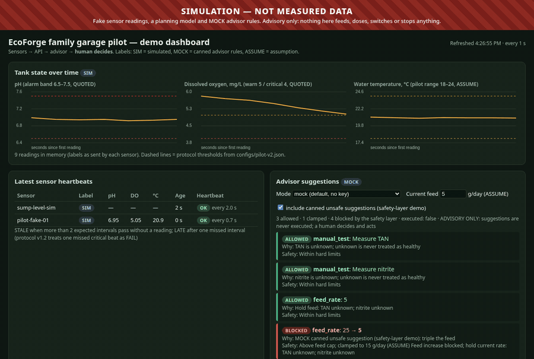
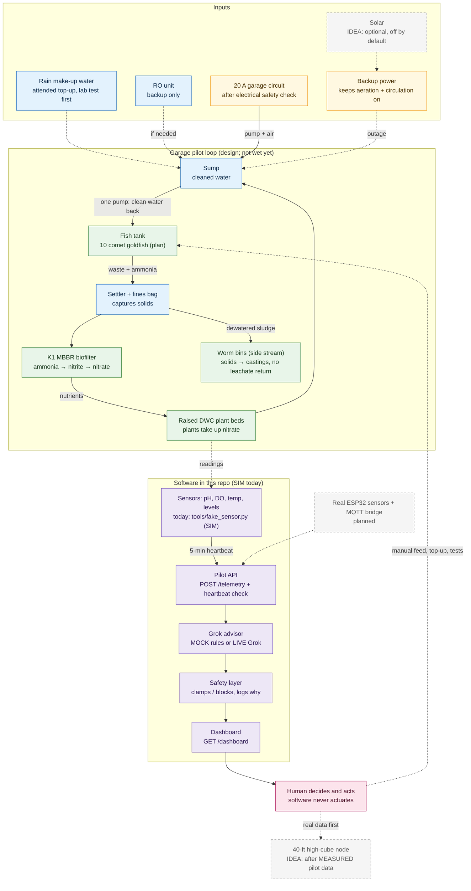

# EcoForge for Humanity

**Open-source closed-loop family nodes**  
Waste → Food → Energy → Knowledge  

Family-forged regenerative systems for Earth abundance — and a practical analog for long-duration life support beyond Earth.


---

## What this is (10-second read)

EcoForge is a family-built, open-source **vermi-aquaponics** node: worms turn waste into fertility, fish feed the plants, plants clean the water, solar and storage keep the critical loops alive, and labeled measurements keep hope from being mistaken for results.

**Right now (November 2026):** a measured garage pilot is the active physical build (starting with goldfish sentinels).  
**Next:** the first **40-ft high-cube** node on purpose-fit family land, once the pilot produces real data and the site is ready.

**Latest snapshot:** [progress/2026-11-update.md](progress/2026-11-update.md)

**Try it:** [Dashboard demo](#try-the-dashboard-demo-3-commands) · [Grok advisor + safety layer](api/README.md#grok-advisor-demo-suggests-never-actuates) · [Sensor heartbeat](api/README.md#sensor-heartbeat-telemetry) · [System diagram](#system-diagram) · [Contributing](CONTRIBUTING.md)



*Recorded on a development computer: a fake sensor (SIM) posts readings every 0.7 s while dissolved oxygen drifts down; the MOCK advisor suggests backup aeration and a feed pause, and the safety layer blocks the canned unsafe suggestions. **Simulation, not measured data.** Nothing is actuated.*

---

## Unique belief

A regular family, without degrees or investors, can build a system that covers its own food, water, and energy — and give the blueprint away. Independence does not require credentials or equity; it requires honest labels, caution-first engineering, and the patience to start small. The same container that feeds a family in Ohio is a rough draft of regenerative life support people will one day need farther from home.

---

## Current obsession

Shipping the first physical system and collecting **MEASURED** data. Everything else — grants, open-source polish, the 40-ft node — serves that proof.

---

## Hero targets (not achievements)

No physical EcoForge node has produced measured surplus yet. Numbers below are **design targets** until a labeled MEASURED result replaces them. Older “sim validated” wording is retired.

| Target | Value | Label | Notes |
|---|---|---|---|
| RO recovery | ≥ 96.5% | TARGET (SIM / ASSUME) | Make-up water path; prove after water test |
| RO effluent TDS | < 6 ppm | TARGET (SIM / ASSUME) | Protocol alarm divert/stop |
| Net energy | +16 kWh/day | TARGET (ASSUME / IDEA) | Design north star; sized from a load ledger, not claimed as proven |
| Surplus produce + protein | ~400 lb/mo | TARGET (ASSUME / IDEA) | Full-node goal; retired as a *promise* until MEASURED |
| Biochar in media | ~35% | TARGET (ASSUME / IDEA) | Design mix; not MEASURED in a live node |
| Sensor heartbeat | every 5 min | TARGET (IDEA) | MQTT mesh; missing beat = fail |
| First fish (pilot) | 10 comet goldfish | IDEA / plan | Sentinels; species for the full node compared later |
| Full-node fish | tilapia hybrid candidate | IDEA | Thesis preference; **not locked** — garage pilot decides |

The full measurement protocol lives locally today. Its pilot alarm thresholds are public, each with label and source, in [configs/pilot-v2.json](configs/pilot-v2.json). Older planning docs (pre-Nov 2026, marked superseded): [docs/Phase1_Checklist.md](docs/Phase1_Checklist.md), [docs/Phase2_Checklist.md](docs/Phase2_Checklist.md), [docs/Simulation-Roadmap.md](docs/Simulation-Roadmap.md).

---

## Best thing pulled off so far

I have no degree in engineering, biology, or agriculture. I work by finding a hard problem and engineering backward from it.

What exists today:

1. **An honest design system** — every number labeled MEASURED, QUOTED, SIM, ASSUME, IDEA, or CALC so nobody confuses a hope with a result.
2. **A tested garage-pilot planning simulator** — FastAPI app with a dissolved-nitrogen model, power budget and protocol alarm rules; every parameter labeled with its source; 127 automated tests across the API, advisor and heartbeat path (MEASURED *software* result, not physical validation): [api/](api/README.md), [configs/pilot-v2.json](configs/pilot-v2.json), [tests/](tests/)
   - **Grok advisor with a caution-first safety layer** — MOCK rules by default (no key), LIVE Grok optional; every suggestion is clamped or blocked against the pilot limits (feed cap, ramp step, temperature range, aeration never stops, no dose amounts) and nothing is ever actuated: [api/advisor/](api/advisor/safety.py)
   - **5-minute sensor heartbeat path + dashboard** — fake SIM sensor → `POST /telemetry` → stale detection → advisor → [dashboard](api/static/dashboard.html); optional [MQTT bridge](tools/mqtt_bridge.py) (live Grok and the MQTT bridge are **not tested against real services**; mock/fake paths are)
3. **Public simulations** you can run — nutrient/vermiponics teaching models and a biogas digestion ODE ([simulations map](simulations/README.md)):
   - [simulations/aquaponics_vermiponics_enhanced_ph_alk.py](simulations/aquaponics_vermiponics_enhanced_ph_alk.py)
   - [simulations/sim_biogas_digestion.py](simulations/sim_biogas_digestion.py)
   - [simulations/energy_basic.py](simulations/energy_basic.py)
4. **Blueprints, BOMs, and ops docs** — [Master-BOM-All-Tiers.md](Master-BOM-All-Tiers.md), [docs/](docs/), [designs/](designs/)
5. **System visuals** — container cutaway, isometric, BOM exploded, Earth/Mars framing:
   - [images/ecoforge-container-cutaway.png](images/ecoforge-container-cutaway.png)
   - [images/ecoforge-isometric-diagram.png](images/ecoforge-isometric-diagram.png)
   - [images/ecoforge-bom-exploded.png](images/ecoforge-bom-exploded.png)
6. **A measured garage pilot ready to build** — floor, power path, rain tank, and layout taped; electrical safety gate before water; goldfish first. (The planning simulator above is public; the rest of the pilot package stays local until the next public release.)
7. **Earlier family proof of agency** — wiring a whole house with family crew, end to end.

People say this is too good to be true. That is why the garage pilot exists: prove it with data, not promises.


---

## Status — November 2026

| Track | Status | Honest note |
|---|---|---|
| Design / docs / sims | Active | Public repo + deeper local packages in progress |
| Garage pilot (small fish–plant–worm bench) | **Active physical path** | Measured space; nothing wet until the electrical gate passes |
| First 40-ft high-cube node | **Planned next** | Purpose-fit family land; stream/pond preferred; one family parcel on hold pending a power upgrade |
| Open-source public release | Staged | Full drop when the pilot story and living docs are ready together |
| Funding | Grants first | No equity. Loans deferred. Crowdfund after MEASURED proof |

### Family crew (roles)

| Role | Focus |
|---|---|
| Coordination / wiring / software | Measurement protocol, MQTT skeleton, Grok optimization path, build sequencing |
| Site / heavy work & plumbing | Pad, tank path, plumbing, biochar retort, physical install |
| Logistics & safety | Delivery, gas/electrical safety review, sequencing |
| Plants & media | Propagation, winter greens, outreach |
| Gray water | Branched-drain path and local rules |


---

## Planned first node (design intent)

One **40-ft high-cube** for fish + water treatment, with plant beds in a greenhouse extension (layout decision locked locally Oct 2026; public diagrams above). Intended stack:

- Vermi-aquaponics + biochar media
- RO make-up after a real water test (rain-first preferred)
- Solar + storage hybrid; critical aeration/circulation protected
- GAHT earth tubes **designed**; install timing still open
- MQTT 5-minute heartbeat on critical sensors
- Grok-assisted optimization once MEASURED streams exist ([docs/Grok-Ara-Integration-Plan.md](docs/Grok-Ara-Integration-Plan.md))
- Dual-use framing: Earth homestead + Mars-analog life-support research ([docs/06_Mars_Analog_RD_Roadmap.md](docs/06_Mars_Analog_RD_Roadmap.md))

**Living BOM:** estimates only; nothing ordered. Public March 2026 tier table: [Master-BOM-All-Tiers.md](Master-BOM-All-Tiers.md). A tighter DIY living BOM is maintained locally and will replace the public table in a future release.

---

## What’s next

1. Clear the garage pilot electrical safety gate (GFCI / fuse-wire check).
2. Build the garage pilot dry, then wet; fishless cycle; goldfish sentinels; log MEASURED water, nutrients, and power.
3. Feed real data back into the models (retire SIM assumptions that fail).
4. Sequence Container 1: site ready → pad/container → plumbing → sensors → greenhouse.
5. Swap the fake SIM sensor for real ESP32 probes on the same heartbeat path (the API ingest, stale check and MQTT bridge example are in-repo now).
6. One coherent public open-source release when the pilot proof and living docs are ready.

---

## Quick start

```bash
git clone https://github.com/SeanSestinaEcoForge/SeanSestinaEcoForge.git
cd SeanSestinaEcoForge
pip install -r requirements.txt
python simulations/aquaponics_vermiponics_enhanced_ph_alk.py
python simulations/sim_biogas_digestion.py
```

Each sim prints its results (all **SIM**) and saves any plot to `outputs/`; nothing blocks on a plot window (add `--show` to open one).

### Try the dashboard demo (3 commands)

```bash
pip install -r requirements-dev.txt
python -m uvicorn api.main:app --host 127.0.0.1 --port 8000 &
python tools/fake_sensor.py --interval 2 --count 60 --scenario do-drop
```

While the fake sensor runs (2 minutes), open `http://127.0.0.1:8000/dashboard`. Everything on it is **SIM** or **MOCK**: a seeded fake sensor, the planning model and the rule-based advisor. Stop the server afterwards with `kill %1` (or run it in a second terminal and press Ctrl-C). No API key or internet needed.

### Run the tested garage-pilot API

```bash
pip install -r requirements-dev.txt
python -m pytest -q                                   # 127 tests
python -m uvicorn api.main:app --host 127.0.0.1 --port 8000
```

Then open `http://127.0.0.1:8000/docs`. Details and example requests: [api/README.md](api/README.md). Development and planning only — not a production control system.

### System diagram

Garage-pilot design plus the software in this repo. Dashed grey boxes are **IDEA / planned**; nothing in the loop is wet yet. Also as [SVG](docs/media/system-diagram.svg).



### Repository map

- `api/` — tested garage-pilot planning API (FastAPI): simulator, alarms, `advisor/` (Grok advisor + safety layer), `telemetry.py` (heartbeat ingest), `static/dashboard.html`; `configs/` — its labeled parameters; `tests/` — pytest suite
- `tools/` — `fake_sensor.py` (SIM heartbeat sender), `mqtt_bridge.py` (optional MQTT → API example), `smoke_local.py` (loopback HTTP smoke test)
- `docs/media/` — dashboard demo GIF and system diagram
- `simulations/` — Python teaching models and a notebook ([map](simulations/README.md))
- `docs/` — philosophy, checklists, roadmaps, integration notes (pre-Nov 2026 docs carry a "superseded" banner)
- `designs/` — layout / homestead sketches (IDEA)
- `progress/` — dated status updates
- `images/` — diagrams and reference photos
- `src/` — optional Grok/xAI helpers (`pip install -r requirements-grok.txt`; need your own `XAI_API_KEY`) and the sensor logger stub
- `chaos-examples/` — example simulation outputs
- `archive/` — duplicates and superseded material kept for history

---

## Safety

EcoForge materials are provided **AS IS** for experimental, educational, and open-source research only. Building or operating these systems involves serious risks (fire/explosion, electrical, chemical, biological, structural). You assume 100% of the risk. Consult licensed professionals, follow codes, get permits, and start small. See [DISCLAIMER.md](DISCLAIMER.md).

---

## Get involved

- Fork and prototype your own small node
- Open issues / PRs (code, docs, sims, corrections) — start with [CONTRIBUTING.md](CONTRIBUTING.md)
- Prefer MEASURED corrections over louder claims

**Current priorities:** garage pilot MEASURED data, sensor/MQTT examples, honest BOM refresh, Container 1 sequencing.

License: [MIT](LICENSE)

Let’s forge abundance together — carefully, and with receipts. 🌱
